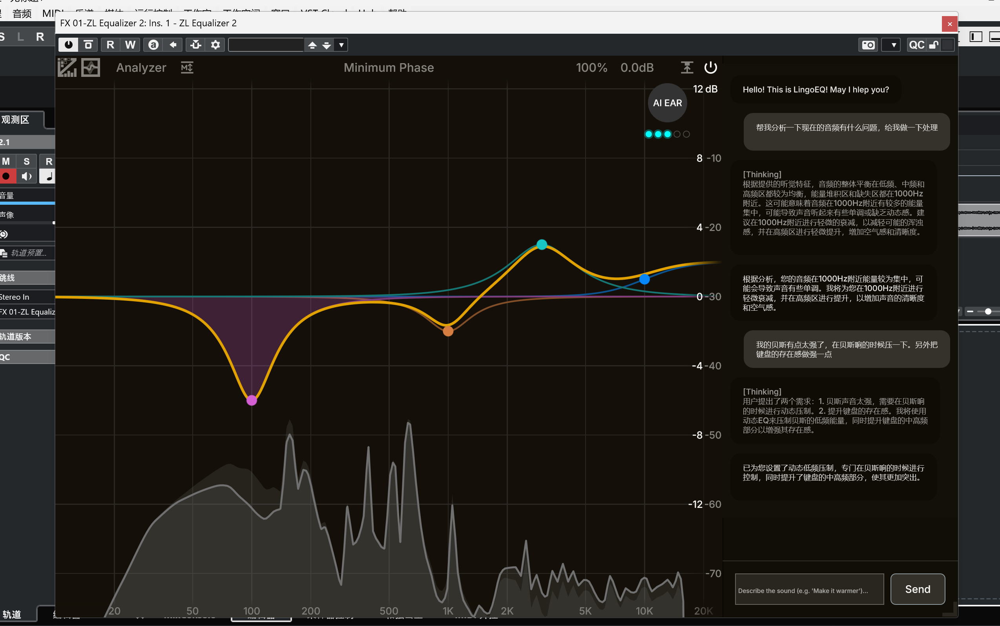

<div align="right">
  <a href="README_CN.md">简体中文</a>
</div>

# 🎚️ LingoEQ

> **"Make the kick punchier, vocals brighter"** — Describe your tone in plain language, let AI precisely adjust 24-band parametric EQ parameters

<div align="center">



*AI understands mixing intent in real-time, automatically adjusts EQ parameters, and self-validates through acoustic feedback*

</div>

---

## ✨ Core Features

### 🗣️ Natural Language Control
Say goodbye to manually dragging 24 frequency bands. Describe your desired tone in conversational language, and LingoEQ automatically translates it into precise frequency, gain, and Q-value parameters.

**Traditional Workflow vs LingoEQ**
```
❌ Manual:  Attenuate 4dB at 800Hz, Q 2.5, filter type Peaking...
✅ LingoEQ: "The vocals sound nasal, clean it up"
```

### 🧠 Neuro-Symbolic Hybrid Architecture
Combines LLM's semantic understanding with hard-coded DSP physical constraints:
- **Neural Layer**: Understands subjective listening terms like "warm", "harsh", "muddy"
- **Symbolic Layer**: Enforces acoustic safety boundaries (frequency 20-20kHz, gain -24 to +18dB)
- **Cognitive Sync**: Bands you manually adjust are permanently locked; AI automatically avoids them

### 🎯 DSP-Aware Interference Attenuation Algorithm
Calculates frequency-domain overlap based on filter bandwidth (Q-value). When AI operations approach user-adjusted bands:
- Automatically calculates octave distance and influence radius between two frequency points
- Attenuates AI gain proportionally to overlap ratio
- Prevents AI operations from interfering with user intent

**Technical Details**: [state_manager.py#L59-L86](app/services/state_manager.py#L59-L86)

---

## 🏗️ System Architecture

LingoEQ adopts an **"AI Brain + DSP Executor"** separated architecture. The Python backend handles understanding and decision-making, while the C++/JUCE plugin handles real-time audio processing.

```
┌─────────────────────────────────────────────────────────────┐
│  C++ Plugin (JUCE)                                          │
│  • 24-band parametric EQ                                    │
│  • Real-time audio processing                               │
│  • Spectrum analyzer & reflexion recorder                   │
└────────────────┬────────────────────────────────────────────┘
                 │ TCP JSON-RPC (port 8888)
                 ▼
┌─────────────────────────────────────────────────────────────┐
│  Python Backend (LingoEQ)                                   │
│                                                              │
│  ┌──────────────────────────────────────────────────────┐  │
│  │  MCPHandler (Central Dispatcher)                     │  │
│  └──────────────────┬───────────────────────────────────┘  │
│                     │                                        │
│  ┌──────────────────▼───────────────────────────────────┐  │
│  │  Step 1: Resource Aggregation (ContextManager)      │  │
│  │  ├─ RouterAgent    → Extract {instruments, keywords}│  │
│  │  ├─ RagEngine      → Retrieve mixing knowledge      │  │
│  │  ├─ StateManager   → Get EQ state + locked bands    │  │
│  │  ├─ SensoryManager → Audio snapshot analysis        │  │
│  │  └─ MemoryManager  → List available presets         │  │
│  └──────────────────┬───────────────────────────────────┘  │
│                     │                                        │
│  ┌──────────────────▼───────────────────────────────────┐  │
│  │  Step 2: Prompt Engineering (PromptEngineer)        │  │
│  │  Inject context into system prompt template         │  │
│  └──────────────────┬───────────────────────────────────┘  │
│                     │                                        │
│  ┌──────────────────▼───────────────────────────────────┐  │
│  │  Step 3: LLM Inference (DeepSeekClient)             │  │
│  │  • Extract <think> tags                              │  │
│  │  • Parse JSON response                               │  │
│  │  • Validate tool calls                               │  │
│  └──────────────────┬───────────────────────────────────┘  │
│                     │                                        │
│  ┌──────────────────▼───────────────────────────────────┐  │
│  │  Step 4: Guardrail Enforcement (StateManager)       │  │
│  │  • Redirect locked bands                             │  │
│  │  • Calculate interference attenuation                │  │
│  │  • Clamp parameters to safe ranges                   │  │
│  └──────────────────┬───────────────────────────────────┘  │
│                     │                                        │
│  ┌──────────────────▼───────────────────────────────────┐  │
│  │  Step 5: Response Serialization                     │  │
│  │  Build content_list → Send to C++                    │  │
│  └──────────────────────────────────────────────────────┘  │
│                                                              │
└─────────────────────────────────────────────────────────────┘
                 │
                 ▼
┌─────────────────────────────────────────────────────────────┐
│  Optional: Reflexion Closed-Loop (max 2 iterations)        │
│  C++ captures pre/post audio → Python analyzes diff →      │
│  LLM self-corrects if new peaks detected                    │
└─────────────────────────────────────────────────────────────┘
```

---

## 🚀 Quick Start

### Prerequisites

- **Python 3.10+**
- **OpenAI-compatible LLM API** (default: [SiliconFlow](https://siliconflow.cn) + DeepSeek V3)
- **C++/JUCE Plugin** (separate repository, listens on port 8888)

### Installation

```bash
# 1. Clone the repository
git clone https://github.com/yuzh16/LingoEQ-agent.git
cd LingoEQ-agent

# 2. Create virtual environment
python -m venv venv
source venv/bin/activate  # Windows: venv\Scripts\activate

# 3. Install dependencies
pip install -r requirements.txt

# 4. Configure environment variables
cp .env.example .env
# Edit .env and fill in your LLM_API_KEY
```

### Run

```bash
python main.py
```

The server starts on `127.0.0.1:8888` and waits for the C++ plugin to connect.

---

## 📂 Project Structure

```
LingoEQ_Project/
├── main.py                        # Entry point: initialize RAG, start TCP server
├── config.py                      # Global settings singleton (loaded from .env)
├── requirements.txt
├── lingoeq_bench_server.py        # Benchmark HTTP facade (POST /benchmark, for LingoEQ-Bench evaluation)
├── .env.example                   # Configuration template
│
├── app/
│   ├── api/
│   │   └── socket_transport.py    # Async TCP transport layer
│   │
│   ├── mcp_protocol/
│   │   └── server.py              # Central dispatcher (handles all JSON-RPC methods)
│   │
│   ├── core/
│   │   ├── context_manager.py     # Resource aggregation (RAG + state + sensory + presets)
│   │   ├── prompt_engineer.py     # Prompt rendering layer
│   │   ├── llm_client.py          # LLM execution (API call, thought extraction, JSON validation)
│   │   └── router_agent.py        # Intent router (extracts instruments + keywords)
│   │
│   ├── services/
│   │   ├── state_manager.py       # Shadow state (24-band mirror + guardrail logic)
│   │   ├── memory_manager.py      # Preset management (ChromaDB CRUD)
│   │   ├── rag_engine.py          # Knowledge retrieval (mixing_tips.json → ChromaDB)
│   │   └── sensory_manager.py     # Audio perception (psychoacoustic weighting, masking threshold, reflexion diff)
│   │
│   └── schemas/
│       ├── eq_protocol.py         # Pydantic models: EQBand, ToolCall, AgentResponse
│       └── tools_schema.py        # LLM tool definitions
│
└── data/
    ├── knowledge_base/
    │   └── mixing_tips.json       # RAG seed data (structured mixing knowledge)
    ├── factory_presets/           # 14 factory preset JSON files
    └── vector_db/                 # ChromaDB persistence directory (gitignored)
```

---

## 🔧 Core Features Explained

### 1️⃣ Dual-Stage Agentic RAG

**Traditional RAG Problem**: When a user says "kick drum is muddy", direct retrieval may match irrelevant "guitar" or "vocal" knowledge.

**LingoEQ Solution**:
1. **RouterAgent** (lightweight LLM) first extracts intent:
   ```json
   {
     "instruments": ["drum"],
     "keywords": ["muddy", "kick", "low-end"]
   }
   ```
2. **RagEngine** performs precise retrieval in ChromaDB based on intent:
   - Hard filter: search only within `drum` category
   - Soft match: vector search using keywords
   - Threshold cutoff: discard results with L2 distance > 1.125

**Result**: Avoids irrelevant knowledge interfering with LLM decisions, especially in multi-instrument scenarios.

---

### 2️⃣ Shadow State & Guardrail System

The Python backend maintains an in-memory mirror of 24 bands, syncing with the C++ plugin in real-time.

#### 🔒 User Intent Protection
```python
# User manually adjusts Band 5 → permanently locked
manual_touch_registry[5] = True

# AI wants to adjust Band 5 → auto-redirect to nearest free band
if target_band in manual_touch_registry:
    target_band = get_nearest_free_band(target_band)
```

#### 📉 Interference Attenuation Algorithm
```python
# Calculate octave distance between two frequency points
d_oct = abs(log2(ai_freq / user_freq))

# Calculate influence radius (based on Q-value)
threshold = (1/(2*ai_q) + 1/(2*user_q)) * SAFETY_MARGIN

# Higher overlap ratio → more AI gain attenuation
if d_oct < threshold:
    overlap_ratio = 1.0 - (d_oct / threshold)
    ai_gain *= (1.0 - overlap_ratio)
```

#### 🛡️ Physical Clamping
```python
# Force clamp all parameters before writing
gain = clamp(gain, -24.0, +18.0)
freq = clamp(freq, 20.0, 20000.0)
q = clamp(q, 0.1, 10.0)
```

---

### 3️⃣ Reflexion Closed-Loop Validation

After AI adjusts parameters, the system automatically validates the result:

```
1. C++ plugin records pre/post spectrum snapshots (20 frames each)
2. Python backend calculates difference:
   - Apply A-weighting (equal-loudness compensation)
   - Calculate masking threshold (filter masked frequencies)
   - Extract significant peaks (potential harsh points)
3. If new issues detected → LLM performs second-pass fine-tuning
4. If validation passes → return hidden status code (no user interruption)
```

**Depth Limit**: Maximum 2 iterations to prevent infinite loops. After exceeding, tool_calls are forcibly cleared.

---

### 4️⃣ Preset System

Supports both **factory presets** and **user presets**, both retrieved via ChromaDB semantic search:

```python
# User says: "Load vocal brightness preset"
# System automatically matches most similar preset (L2 distance < 1.3)
preset = memory_manager.load_preset("vocal brightness")

# Loading also follows guardrail rules:
# - Locked bands auto-redirect
# - Parameter safety clamping
```

---

## 🌐 JSON-RPC Protocol

The C++ plugin communicates with the Python backend via TCP Socket using newline-delimited JSON messages.

### Supported Methods

| Method | Direction | Description |
|--------|-----------|-------------|
| `chat/send` | Plugin → Python | Send user message, returns thought chain + reply + tool calls |
| `eq/sync` | Plugin → Python | Sync single parameter (triggers band lock) |
| `audio/snapshot_upload` | Plugin → Python | Upload spectrum snapshot to specified slot |
| `audio/snapshot_delete` | Plugin → Python | Delete specified slot snapshot |
| `audio/reflexion_diff_upload` | Plugin → Python | Upload pre/post comparison frames, trigger closed-loop validation |
| `ping` | Plugin → Python | Heartbeat |

### Example: chat/send

**Request**:
```json
{
  "jsonrpc": "2.0",
  "id": 1,
  "method": "chat/send",
  "params": {
    "content": "The vocals sound nasal, clean it up",
    "auto_check": true
  }
}
```

**Response**:
```json
{
  "jsonrpc": "2.0",
  "id": 1,
  "result": {
    "role": "assistant",
    "content": [
      {
        "type": "text",
        "role": "thought",
        "text": "Nasal tone typically sits around 800Hz-1.2kHz, requires narrow Q attenuation..."
      },
      {
        "type": "text",
        "role": "assistant",
        "text": "Done — I've cleaned up the nasal frequency range around 1kHz."
      },
      {
        "type": "tool_use",
        "tool": "adjust_eq_band",
        "args": {
          "band_index": 7,
          "freq": 1000.0,
          "gain": -4.0,
          "q": 2.5,
          "filter_type": "Peaking",
          "enabled": true
        }
      }
    ]
  }
}
```

---

## ⚙️ Configuration

All hyperparameters are centralized in `config.py` and can be overridden via `.env`.

### Core Configuration

| Variable | Description | Default |
|----------|-------------|---------|
| `LLM_API_KEY` | LLM API key | *Required* |
| `LLM_BASE_URL` | API base URL | `https://api.siliconflow.cn/v1` |
| `LLM_MODEL_NAME` | Model name | `deepseek-ai/DeepSeek-V3` |
| `LLM_TEMPERATURE` | Inference temperature | `0.3` |
| `MAX_REFLEXION_DEPTH` | Max closed-loop validation depth | `2` |
| `WS_PORT` | TCP port (must match C++ plugin) | `8888` |

### RAG Configuration

| Variable | Description | Default |
|----------|-------------|---------|
| `RAG_TOP_K` | Number of knowledge entries injected per query | `5` |
| `RAG_DISTANCE_THRESHOLD` | L2 distance threshold | `1.125` |
| `PRESET_DISTANCE_THRESHOLD` | Preset matching threshold | `1.3` |
| `MAX_CONVERSATION_HISTORY` | Max conversation turns carried in context | `5` |

### Psychoacoustic & Sensory

| Variable | Description | Default |
|----------|-------------|---------|
| `PSYCHOACOUSTIC_MODEL` | Weighting model: `a_weighting` / `k_weighting` / `iso226_80phon` | `a_weighting` |
| `MAX_SENSORY_SLOTS` | Max cached audio snapshot slots | `5` |
| `SENSORY_TOP_PEAKS` | Max prominent peaks reported per snapshot | `3` |
| `SENSORY_TOP_VALLEYS` | Max prominent valleys reported per snapshot | `2` |

### Physical Guardrails

| Variable | Description | Default |
|----------|-------------|---------|
| `GAIN_LIMIT_MIN` / `MAX` | Gain range (dB) | `-24.0` / `+18.0` |
| `FREQ_LIMIT_MIN` / `MAX` | Frequency range (Hz) | `20.0` / `20000.0` |
| `Q_LIMIT_MIN` / `MAX` | Q-value range | `0.1` / `10.0` |
| `SAFETY_MARGIN` | Interference calculation safety factor | `1.2` |

See [.env.example](.env.example) for the complete configuration list.

---

## 🔄 Switching LLM Providers

LingoEQ uses the OpenAI SDK and supports any OpenAI-compatible provider:

```bash
# Use official OpenAI
LLM_BASE_URL=https://api.openai.com/v1
LLM_MODEL_NAME=gpt-4o
LLM_API_KEY=sk-...

# Use local Ollama
LLM_BASE_URL=http://localhost:11434/v1
LLM_MODEL_NAME=llama3

# Use Azure OpenAI
LLM_BASE_URL=https://your-resource.openai.azure.com/openai/deployments/your-deployment
LLM_MODEL_NAME=gpt-4
```

**Requirement**: Model must support **JSON Mode** (`response_format: json_object`).

---

## 🎓 Tech Stack

| Layer | Technology |
|-------|------------|
| Runtime | Python 3.10+, asyncio (Windows-first) |
| LLM Interface | OpenAI SDK (compatible interface) |
| Data Validation | Pydantic v2 |
| Vector Database | ChromaDB (local persistence) |
| Embedding Model | SentenceTransformer `all-MiniLM-L6-v2` |
| Transport Protocol | Custom JSON-RPC over TCP (newline-delimited) |
| Configuration | `python-dotenv` + singleton pattern |

---

## 🤝 Related Projects

- **C++/JUCE Plugin**: [LingoEQ-Plugin](https://github.com/yuzh16/LingoEQ-plugin)

---

## 📄 License

*To be determined*

---

<div align="center">

**If this project helps you, please give it a Star ⭐**

</div>
